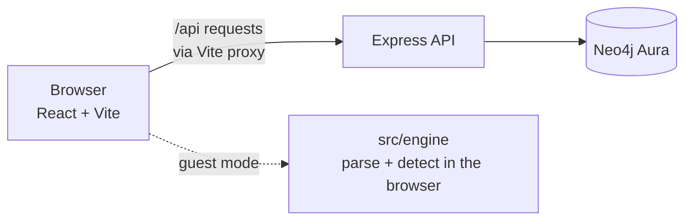

# Loss Finder

**Find the recurring payments hiding in your bank statement.**

Loss Finder is a prototype built for the **Neo4j track** problem statement *"The Auto Debits Nobody Can Find"*. Upload a bank statement CSV and the app turns confusing transaction strings into a clear list of subscriptions, catches price hikes, spots free trials that quietly became paid plans, and (optionally) flags services you pay for but no longer use. For signed-in users, everything is stored per user in a **Neo4j graph database**.

> **Demo video:** _add your link here_
> **Team:** _add team member names here_

---

## Contents

- [The problem](#the-problem)
- [What Loss Finder does](#what-loss-finder-does)
- [How it works](#how-it-works)
- [Tech stack](#tech-stack)
- [How the data is stored (Neo4j graph)](#how-the-data-is-stored-neo4j-graph)
- [Project structure](#project-structure)
- [Getting started](#getting-started)
- [Using the app](#using-the-app)
- [API overview](#api-overview)
- [Security and privacy](#security-and-privacy)
- [Before you deploy](#before-you-deploy)
- [Troubleshooting](#troubleshooting)
- [Limitations](#limitations)
- [Future work](#future-work)
- [License](#license)

---

## The problem

Most people pay for several subscriptions and auto-debits and cannot say where the money goes. A bank statement does not help: a charge looks like `UPI/SPOTIFY/XXbdsi@hdfcban/Execution/HDFC B...`, not "Spotify". When a price goes up in the middle of the year, or a free trial converts to a paid plan, nobody notices.

## What Loss Finder does

- **Simplifies statement strings** into a real merchant name and category (for example `CARD/RECUR/AMAZON_PRIME_IN` becomes *Amazon Prime, Shopping*).
- **Detects recurring payments** that are monthly, quarterly or yearly, even when amounts vary slightly.
- **Flags price hikes** and shows the old price, the new price and the extra cost per year.
- **Spots trial conversions**, such as a ₹2 trial charge followed by a ₹1,400 monthly plan.
- **Shows ended subscriptions** whose charges have stopped.
- **Flags possibly unused services** when an optional usage log shows no activity for 60 days or more while the charges continue.
- **Shows the evidence** behind every detection, a price history chart, a cancellation guide and an annual view.
- **Works as a guest** (nothing is saved) or with an account (data is stored in Neo4j).

> **About the usage log:** it is an optional CSV in this prototype. It is the early version of a bigger idea: in the future, usage data could come automatically from the apps themselves.

<!-- Add screenshots here, for example:

-->

## How it works



- **Guest mode:** the CSV is parsed and analysed entirely in your browser (`src/engine`). Nothing is sent to the server or saved.
- **Account mode:** the parsed transactions are sent to the API, stored in Neo4j, and the server runs the detection and returns the subscriptions.

### Detection rules

1. Each narration is matched to a known merchant and category.
2. Charges are grouped per merchant. Two charges within 7 days are treated as a possible double charge.
3. A cadence is detected: monthly (3+ charges about 30 days apart), quarterly (3+ about 91 days) or yearly (2+ about 365 days).
4. A **price hike** is a higher amount that stays for at least two charges.
5. A **trial** is a ₹0 authorisation or a tiny first charge followed by a much larger one.
6. A subscription is **ended** when no charge appears for much longer than its cycle.
7. A subscription is **possibly unused** when the usage log shows no activity for 60 days or more while charges continue.
8. One-off manual UPI payments and charges with very different amounts are ignored.

The rules are deterministic. **No machine learning is used.**

## Tech stack

| Layer | Technology |
|---|---|
| Frontend | React 19, Vite 6 |
| Backend | Node.js, Express (CommonJS) |
| Database | Neo4j Aura (graph database) via `neo4j-driver` |
| Auth | bcryptjs password hashing, JWT in an HTTP-only cookie |
| Security | helmet, cors, express-rate-limit, zod input validation |
| Logging | morgan and a small JSON logger |

## How the data is stored (Neo4j graph)

```
(User)-[:MADE]->(Transaction)-[:PAID_TO]->(Merchant)
(Transaction)-[:IN_IMPORT]->(ImportBatch)
(User)-[:TRACKS]->(Subscription)-[:FOR_MERCHANT]->(Merchant)
```

Each user is connected to the transactions they made, each transaction to a merchant, and each detected subscription back to the user and the merchant. Every user's data is kept separate.

**Explore it yourself:** open the Neo4j Aura console, choose **Query**, and run:

```cypher
MATCH (u:User)-[:TRACKS]->(s:Subscription)-[:FOR_MERCHANT]->(m:Merchant)
RETURN u, s, m LIMIT 25
```

## Project structure

```
hackfront/
├── backend/
│   ├── config/          # environment and Neo4j connection
│   ├── controllers/     # request handlers
│   ├── middleware/      # auth and validation
│   ├── repositories/    # all Neo4j queries
│   ├── routes/          # API routes
│   ├── services/        # import, detection and analytics logic
│   ├── utils/           # logger, merchant matching, fingerprints
│   ├── validators/      # zod schemas
│   ├── .env.example     # template for your own .env
│   ├── app.js
│   └── server.js
├── src/
│   ├── components/      # Upload, Dashboard, DetailView, CancelGuide, AnnualView, ...
│   ├── context/         # AppContext (global state)
│   ├── data/            # demo data
│   ├── engine/          # client-side parsing and detection (used in guest mode)
│   ├── hooks/           # API hook
│   └── services/        # API client
├── sample-data/         # demo statement and usage log
├── index.html
├── vite.config.js
└── package.json
```

## Getting started

### Prerequisites

- **Node.js 18 or newer** (20 LTS recommended) and npm
- A free **[Neo4j Aura](https://neo4j.com/cloud/aura/)** instance (note its URI, username and password)

### 1. Clone and install

```bash
git clone <your-repo-url>
cd <repo-folder>

# frontend packages
npm install

# backend packages
cd backend
npm install
cd ..
```

### 2. Configure the backend

Create a file named `.env` inside the `backend/` folder. Copy the template, then fill in your own values:

```bash
# macOS / Linux / PowerShell
cp backend/.env.example backend/.env

# Windows Command Prompt
copy backend\.env.example backend\.env
```

| Variable | Description |
|---|---|
| `PORT` | Backend port (`8000`) |
| `NODE_ENV` | `development` for local work |
| `FRONTEND_ORIGIN` | Where the frontend runs (`http://localhost:3000`) |
| `JWT_SECRET` | Long random string used to sign login tokens |
| `COOKIE_SECURE` | `false` on local http, `true` when served over HTTPS |
| `NEO4J_URI` | Aura connection URI, like `neo4j+s://xxxxxxxx.databases.neo4j.io` |
| `NEO4J_USERNAME` | Aura username |
| `NEO4J_PASSWORD` | Aura password |
| `NEO4J_DATABASE` | Database name shown in the Aura console |

Generate a strong `JWT_SECRET` with:

```bash
node -e "console.log(require('crypto').randomBytes(48).toString('hex'))"
```

> The variable names must match `backend/config/env.js`. If they differ, follow that file. **Never commit your real `.env`.**

### 3. Run it (two terminals)

**Terminal 1: backend**

```bash
cd backend
npm run dev        # restarts automatically on changes
# or: node server.js
```

You should see `Connected to Neo4j` and `Loss Finder server running at http://localhost:8000`.

**Terminal 2: frontend** (from the folder that contains the root `package.json`)

```bash
npm run dev
```

Open **http://localhost:3000**. The Vite dev server forwards every `/api` request to the backend on port 8000. Open the app on port 3000, not on 8000.

## Using the app

1. **Register** an account, or choose **Continue as guest**.
2. Upload your **bank statement** CSV (required).
3. Optionally upload a **usage log** CSV.
4. Click **Upload & Analyze**, or click **Load sample data**.

To try the demo files, upload `loss_finder_statement_12m.csv` from `sample-data/` as the statement and `loss_finder_usage_log.csv` as the usage log. The demo data contains a yearly Amazon Prime plan that is never used, two price hikes (YouTube and a gym), a trial that converts to a paid plan, and ordinary food and ride payments that should be ignored.

### Statement CSV format

The statement needs a date column, a narration/description column and a debit or amount column, for example:

```
Date,Narration,Chq./Ref.No.,Withdrawal Amt.,Deposit Amt.,Closing Balance
12/10/2026,UPI/YOUTUBE/AUTOPAY_REC,YT202610,149,,904352
```

The optional usage log looks like this:

```
Date,Service,Action
15/10/2026,Youtube,Watched video
```

Duplicate transactions (same date, amount, description and reference) are skipped when you upload again.

## API overview

All routes except register, login and health need a logged-in session.

| Area | Endpoints |
|---|---|
| Health | `GET /api/health` |
| Auth | `POST /api/auth/register`, `POST /api/auth/login`, `POST /api/auth/logout`, `GET /api/auth/me`, `DELETE /api/auth/me/data` |
| Imports | `POST /api/imports`, `GET /api/imports`, `GET /api/imports/:id`, `DELETE /api/imports/:id` |
| Subscriptions | `GET /api/subscriptions`, `GET /api/subscriptions/:id`, `PATCH /api/subscriptions/:id`, `POST /api/subscriptions/reanalyze` |
| Usage | `GET /api/usage`, `POST /api/usage`, `DELETE /api/usage/:id` |
| Analytics | `GET /api/analytics/summary`, `/monthly`, `/categories`, `/savings`, `/upcoming` |

## Security and privacy

- Passwords are hashed with bcrypt and never stored as plain text.
- Login uses a signed JWT in an HTTP-only cookie.
- Requests are validated with zod, and rate limiting and secure headers (helmet) are enabled.
- Each user can only read their own data.
- Secrets live in `backend/.env`, which is excluded from Git.
- **Guest mode** keeps your statement in the browser only. **Account mode** stores your parsed transactions in Neo4j. You can remove everything you stored at any time with `DELETE /api/auth/me/data`.

## Before you deploy

This project is a hackathon prototype. Before putting it on the internet:

- Set a long random `JWT_SECRET` (never the default).
- Set `NODE_ENV=production` and `COOKIE_SECURE=true`, and serve everything over HTTPS.
- Allow only your real frontend address in the CORS settings.
- Build the frontend (`npm run build`) and serve only the built files, not the whole repository folder.
- Use fresh Neo4j credentials that were never shared or committed.

## Troubleshooting

| Problem | What to do |
|---|---|
| `npm error ... Could not read package.json` | You are in the wrong folder. Run `cd` into the folder that contains `package.json` (the project root for the frontend, `backend/` for the server). |
| `Invalid environment variables` when the backend starts | `backend/.env` is missing, or a variable name does not match `backend/config/env.js`. |
| Backend starts but says Neo4j is offline | Check `NEO4J_URI` (it should start with `neo4j+s://`), the username and password, and that the Aura instance is running. Free Aura instances pause when idle; resume it in the Aura console. |
| Login works but the next request returns 401 | Open the app at `http://localhost:3000`, not the backend port, and keep `COOKIE_SECURE=false` on local http. |
| `Port already in use` | Stop the other process, or change `PORT` in `backend/.env` (and the proxy target in `vite.config.js`). |
| "No transactions" after uploading | Check that the CSV has a header row with date, narration and debit columns, and that it is the CSV export, not a PDF or Excel file. |

## Limitations

- The data used is **synthetic**. No real bank login or real statements are needed.
- Detection is rule-based and written for common Indian bank CSV layouts. Unusual column names or date styles may need small adjustments.
- The usage log is a manual upload in this prototype.
- The merchant list is hand-built, so unknown merchants fall back to a cleaned-up version of the statement text.
- Monthly payments to a person (for example rent or tuition) can look like subscriptions.

## Future work

- Automatic usage data from apps instead of a manual CSV
- Reading statements directly (PDF, Excel, Account Aggregator)
- More banks and merchants
- Reminders before renewals and one-click cancellation help

## License

MIT. See the `LICENSE` file.
